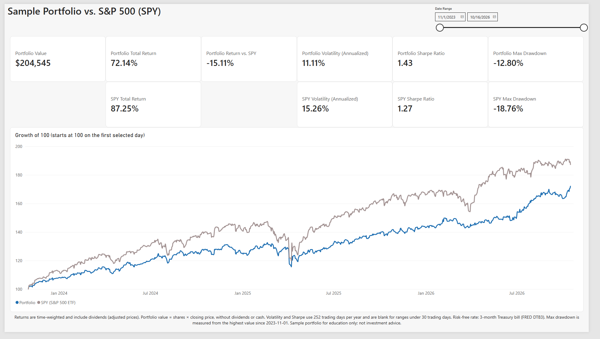
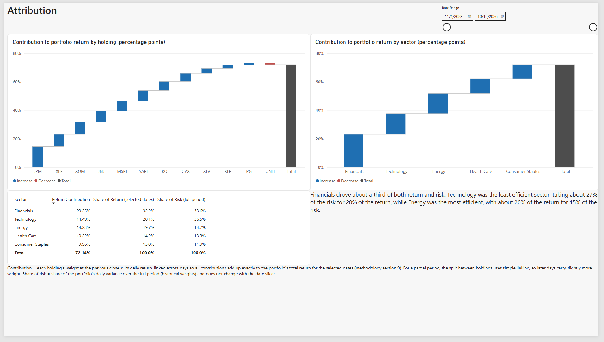
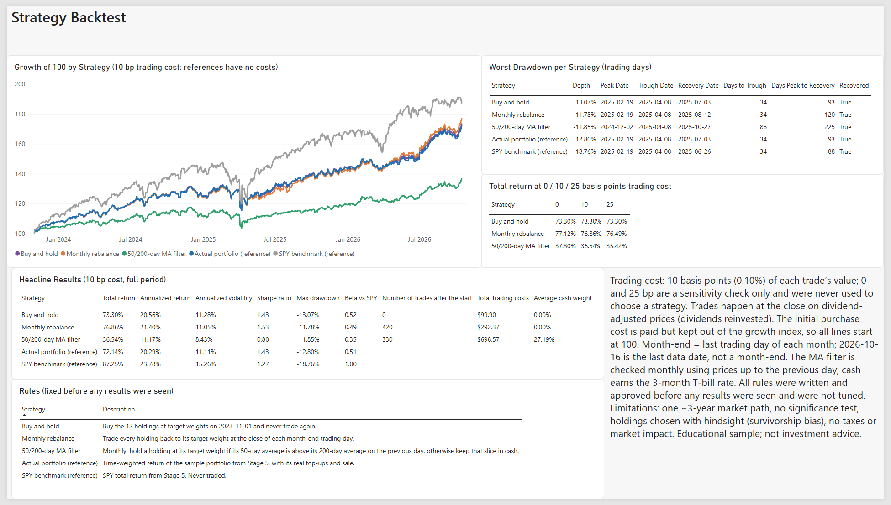

# Investment Portfolio Analytics

> Educational project built on a clearly labeled **fictional sample portfolio**. Not investment advice, not a recommendation to buy or sell anything, and not anyone's real holdings.

## Business question and top finding

**Is the sample portfolio beating its benchmark, the S&P 500 (SPY), after accounting for risk?**

**No on raw return, yes on risk-adjusted return.** From 2023-11-01 to 2026-10-16, the 12-holding sample portfolio returned **72.14%** versus **87.25%** for SPY, trailing by **15.11 percentage points**. It did so with much less risk: annualized volatility of **11.11%** vs **15.26%**, a beta of **0.51**, and a worst drawdown of **-12.80%** vs **-18.76%**. That gives it the higher Sharpe ratio, **1.43** vs **1.27**.



## The five questions this dashboard answers

| # | Question | Answer (full period, 2023-11-01 to 2026-10-16) |
|---|---|---|
| 1 | Is the portfolio beating its benchmark after accounting for risk? | It trails SPY on total return (72.14% vs 87.25%) but has a higher Sharpe ratio (1.43 vs 1.27), because volatility is lower (11.11% vs 15.26%). |
| 2 | Which holdings and sectors drive return, and which drive risk? | JPM contributed the most, at 14.63 of the 72.14 percentage points. UNH was the only negative contributor (-1.06 pts; its own return was -19.59%). Financials delivered 32.2% of the return and 33.6% of the risk. Technology was the least efficient sector (20.1% of return for 26.5% of risk), and Energy the most efficient (19.7% of return for 14.7% of risk). |
| 3 | How concentrated is the portfolio, and how far has it drifted from target weights? | On 2026-10-16: an effective number of holdings of 10.5 out of 12, and the top 5 holdings make up 56.18% of value. The largest drift is JPM at +4.28 points over target; UNH (-3.84) and AAPL (-3.78) are the most underweight. |
| 4 | How deep were the worst drawdowns, and how long did recovery take? | Both series had their worst fall from 2025-02-19 to 2025-04-08. The portfolio fell less (-12.80% vs -18.76%) but recovered slightly later: 59 trading days from the low (2025-07-03), against 54 for SPY (2025-06-26). |
| 5 | Would a simple rebalancing rule have improved results? | In this backtest, monthly rebalancing returned 76.86% vs 73.30% for buy-and-hold (Sharpe 1.53 vs 1.43; max drawdown -11.78% vs -13.07%) after a 10 bp trading cost, and it stayed ahead at 0 and 25 bp. A 50/200-day moving-average filter returned only 36.54%. This is one ~3-year market path with no significance test, so treat it as a description of history, not evidence that the rule works. |

## Data

| What | Source | Notes |
|---|---|---|
| Daily prices, dividends, splits | [yfinance](https://github.com/ranaroussi/yfinance) (unofficial Yahoo Finance library) | 12 holdings + SPY, 2022-12-01 to 2026-10-16. The extra year before the start date is only used to warm up the 200-day moving average. Every raw download is saved under `data/raw/`. |
| Risk-free rate | FRED series **DTB3** (3-month Treasury bill, secondary market) via the FRED API | Converted from a discount rate to a bond-equivalent yield, then to a daily rate. |
| Sector, asset class, target weights | `data/processed/security_lookup.csv` (typed by hand) | 9 stocks and 3 sector ETFs (XLF, XLV, XLP) across 5 sectors. |
| Trades | `data/processed/transactions.csv` (fictional) | 23 trades: 12 initial buys on 2023-11-01, 10 later top-ups and 1 sale. Trades execute at the closing price. |

The analysis period is 2023-11-01 (base day) to 2026-10-16, which is 741 daily returns.

## Method

```
yfinance / FRED  ->  data/raw/*.csv  ->  Python checks  ->  PostgreSQL (staging -> star schema)
                                                                    |
                         pandas analysis + backtest  <--------------+
                                    |
                   results written back to PostgreSQL  ->  Power BI (Import mode)
```

- **Python (pandas)** downloads the data, validates it and loads PostgreSQL. It computes every return, risk and backtest number and writes the results back to the database.
- **PostgreSQL** holds a star schema: `dim_date`, `dim_security`, `dim_strategy`, fact tables for prices, trades, rates, daily portfolio results, holding returns, risk and the backtest, plus the view `vw_daily_holdings` (shares and market value per holding per day).
- **Power BI** only aggregates and filters the stored results with DAX. It does not recalculate returns.

Key definitions (full detail in [`docs/methodology.md`](docs/methodology.md)):

- **Returns** are computed from dividend-adjusted closes, so dividends are reinvested. Market value uses the actual close.
- **Portfolio return is time-weighted.** Each day = sum of (weight at the previous close × holding return). Money added or withdrawn is never counted as performance.
- **Annualized volatility** = sample standard deviation of daily returns × √252.
- **Sharpe ratio** = (annualized return − average risk-free rate) ÷ annualized volatility.
- **Beta** = sensitivity to SPY, using daily returns minus the risk-free rate.
- **Drawdown** = fall from the highest value reached since 2023-11-01.
- **Return contribution** is linked across days, so holdings add up exactly to the total return.
- **Backtest:** buy-and-hold vs monthly rebalancing vs a 50/200-day moving-average filter. It assumes a 10 basis-point cost per trade, and 0 and 25 bp are shown only as a sensitivity check. All rules were written down in [`docs/backtest_rules.md`](docs/backtest_rules.md) before any result was seen, and none were tuned.

## Validation

- **106 automated PASS/FAIL checks** (34 raw-data, 28 model, 22 analysis, 22 backtest), all passing.
- **Every DAX measure** matches the Python result to within 0.000000001. These checks live on a hidden "Checks" page in the `.pbix`, and the formulas are in [`docs/dax_measures.md`](docs/dax_measures.md).
- **Three hand checks in Excel** ([`docs/reconciliation.md`](docs/reconciliation.md)), all passing:
  - one holding's market value on four dates, which matched to the cent
  - the portfolio's return on one day, which matched to 9 decimal places
  - one monthly-rebalance trade date, including its trading cost, which matched exactly

## Results

| Page | Screenshot |
|---|---|
| Executive summary: KPIs and growth of 100 vs SPY | [01_executive_summary.png](docs/screenshots/01_executive_summary.png) |
| Holdings & allocation: weights, drift, concentration, sector treemap | [02_holdings_allocation.png](docs/screenshots/02_holdings_allocation.png) |
| Risk: rolling volatility, drawdowns, correlation matrix, beta, risk share by sector | [03_risk.png](docs/screenshots/03_risk.png) |
| Attribution: contribution waterfalls, return share vs risk share | [04_attribution.png](docs/screenshots/04_attribution.png) |
| Strategy backtest: three rules vs the actual portfolio and SPY | [05_strategy_backtest.png](docs/screenshots/05_strategy_backtest.png) |
| Notes: methodology, assumptions, limitations, disclaimer | [06_notes.png](docs/screenshots/06_notes.png) |





## Limitations

- **Survivorship and hindsight bias.** The holdings were chosen in 2026, knowing they still exist and are large companies.
- **One market path.** About three years of history with no significance test, so differences between strategies may be noise.
- **Simplified trading.** Fills at the closing price, a flat cost per trade, and no taxes, slippage or market impact. The portfolio holds no cash.
- **Data source.** yfinance is unofficial and can break, and it restates older adjusted prices when new dividends are paid, so a fresh download may shift historical numbers slightly.
- **Partial date ranges.** When a shorter date range is selected in the dashboard, holding contributions use simple linking, so later days carry slightly more weight.

## How to reproduce

**Prerequisites:** Windows, Python 3, PostgreSQL (with pgAdmin), Power BI Desktop (free) and a free [FRED API key](https://fred.stlouisfed.org/docs/api/api_key.html).

1. Clone the repository and create a virtual environment. Then run:
   ```
   pip install -r requirements.txt
   ```
2. In pgAdmin, create an empty database named `portfolio_analytics` and a user that can write to it.
3. Copy `.env.example` to `.env` and fill in your database user, password and FRED API key. `.env` is excluded by `.gitignore` and never committed.
4. From the project folder, run these one at a time. Each script prints PASS/FAIL lines and must finish with everything passing.
   ```
   python src/check_setup.py
   python src/ingest_prices.py
   python src/ingest_rates.py
   python src/check_raw_data.py
   python src/load_staging.py
   python src/build_model.py
   python src/reconcile_holdings.py
   python src/build_analysis.py
   python src/build_backtest.py
   ```
5. Open `dashboard/portfolio_analytics.pbix`. Click **Home → Refresh** and enter your database user and password when asked. Check that the Notes page shows the new "Data through" date.

Step 4 downloads fresh data, so your numbers will cover a later end date and will differ from the ones above. To recreate the exact numbers in this README, skip `ingest_prices.py` and `ingest_rates.py` and use the saved CSVs in `data/raw/`. More detail is in [`docs/powerbi_model.md`](docs/powerbi_model.md).

## Project layout

| Folder | Contents |
|---|---|
| `data/raw` | Raw downloads exactly as received (prices, dividends, splits, DTB3, download log) |
| `data/processed` | Hand-typed sample inputs: security lookup and trade log |
| `sql` | Schema, model load, views, validation and reconciliation queries (01 to 10) |
| `src` | Python pipeline: ingest, checks, load, analysis, backtest |
| `dashboard` | Power BI file |
| `docs` | Methodology, backtest rules, DAX measures, Power BI model, hand checks, screenshots |

## Tools

Python (pandas, SQLAlchemy, psycopg2, yfinance), PostgreSQL, Power BI Desktop (DAX), Git.
